# 💫 About Me:
🔖 Building AI x Web3  
⛰️ Part-time hiker

## 🌐 Socials:
  

## 🎮 Mission Select

<b>Mission 01 · nearbuddy</b> — stress-test AI trading agents in public

 

A public stress test for AI trading agents on NEAR: bonded, open to attack by anyone, every decision signed in an enclave and verified on chain.

[▶ Play live](https://nearbuddy.vercel.app) · [Source](https://github.com/LingSiewWin/nearbuddy)

<b>Mission 02 · Tami</b> — the account you give your agents

 

Agents pay in USDC inside a mandate you signed once. Mandates on-chain, a book both sides sign, USDC on Arc.

[▶ Play live](https://tami-home.up.railway.app) · [Source](https://github.com/LingSiewWin/Tami)

<b>Mission 03 · claudia</b> — an allowance, not your keys

 

The human authority layer for AI agents. The agent proposes, a deterministic engine checks the proposal against a mandate.

[▶ Play live](https://claudiahq.vercel.app/) · [Source](https://github.com/LingSiewWin/claudia)

<b>Mission 04 · HumanMandate</b> — spending rules bound to a person

 

An allowance bound to a person, not an address. Enforced in Solidity, with Uniswap execution and an on-chain slippage floor. Live on World Chain mainnet.

[▶ Play live](https://human-mandate.vercel.app/desk) · [Source](https://github.com/LingSiewWin/HumanMandate)

<b>Mission 05 · grazey</b> — a grace period for agent payments

 

Every agent payment gets a grace period. Recourse for autonomous agent payments, on Arc.

[Source](https://github.com/LingSiewWin/grazey)

## 📈 GitHub Statistics

📊 Click to see more GitHub statistics

### Traditional GitHub Stats
  

### Contribution Streak

---

# 💻 Tech Stack:
<table>
  <tr>
    <td><b>Languages</b></td>
    <td>   </td>
  </tr>
  <tr>
    <td><b>Web3</b></td>
    <td> </td>
  </tr>
  <tr>
    <td><b>Web</b></td>
    <td>    </td>
  </tr>
  <tr>
    <td><b>AI / ML</b></td>
    <td>    </td>
  </tr>
  <tr>
    <td><b>Experience</b></td>
    <td></td>
  </tr>
</table>

## 👀 Visitors

