   
  🔖 Building AI x Web3 &nbsp;·&nbsp; ⛰️ Part-time hiker

## 🗂️ Past Projects

**What I build:** AI agents that can handle money safely. Mandates, allowances, bonds and enclave-signed decisions, enforced on chain.

<b>Shipped on:</b>&nbsp; &nbsp;<b>NEAR</b> &nbsp;·&nbsp; &nbsp;<b>Arc&nbsp;/&nbsp;Circle</b> &nbsp;·&nbsp; &nbsp;<b>Arkiv</b> &nbsp;·&nbsp; &nbsp;<b>Cardano</b> &nbsp;·&nbsp; &nbsp;<b>Chainlink</b> &nbsp;·&nbsp; &nbsp;<b>World&nbsp;Chain</b> &nbsp;·&nbsp; &nbsp;<b>Uniswap</b> &nbsp;·&nbsp; &nbsp;<b>Scaffold-ETH</b> &nbsp;·&nbsp; &nbsp;<b>Ethereum</b> &nbsp;·&nbsp; &nbsp;<b>Oasis&nbsp;Sapphire</b> &nbsp;·&nbsp; &nbsp;<b>Base</b> &nbsp;·&nbsp; &nbsp;<b>x402</b> &nbsp;·&nbsp; &nbsp;<b>Aptos</b> &nbsp;·&nbsp; &nbsp;<b>XRP&nbsp;Ledger</b>

<table>
  <tr>
    <td width="50%" valign="top">
      <h3><a href="https://nearbuddy.vercel.app">nearbuddy</a></h3>
      📍 NEAR Hackathon 2026 
      <b>Stress-test AI trading agents in public</b>  
      A public stress test for AI trading agents on NEAR: bonded, open to attack by anyone, every decision signed in an enclave and verified on chain.  
      &nbsp;<b>NEAR</b> 
      <code>TEE enclave</code> <code>AI agents</code>  
       
    </td>
    <td width="50%" valign="top">
      <h3><a href="https://cortex-arkiv.vercel.app">Cortex</a></h3>
      📍 Arkiv × ETHNS Builder Challenge 2026 
      <b>Darwinian memory for AI agents</b>  
      Memory that evolves on Arkiv: memories an agent cites live longer, unused ones decay. Wallet-owned, RaBitQ-compressed, sealed client-side. Live console and MCP server.  
      &nbsp;<b>Arkiv</b> 
      <code>MCP</code> <code>AI + Privacy</code>  
      
    </td>
  </tr>
  <tr>
    <td width="50%" valign="top">
      <h3><a href="https://arcane-arc.vercel.app">arcane</a></h3>
      <b>On-chain trading arena</b>  
      An arena where you watch live autonomous agents trade, on chain.  
      &nbsp;<b>Arc&nbsp;/&nbsp;Circle</b> 
      <code>Autonomous agents</code>  
      
    </td>
    <td width="50%" valign="top">
      <h3><a href="https://claudiahq.vercel.app/">claudia</a></h3>
      <b>An allowance, not your keys</b>  
      The human authority layer for AI agents. The agent proposes, a deterministic engine checks the proposal against a mandate.  
      &nbsp;<b>Cardano</b> &nbsp;·&nbsp; &nbsp;<b>Chainlink</b> &nbsp;·&nbsp; &nbsp;<b>x402</b> 
      <code>Agent payments</code> <code>Mandates</code>  
       
    </td>
  </tr>
  <tr>
    <td width="50%" valign="top">
      <h3><a href="https://human-mandate.vercel.app/desk">HumanMandate</a></h3>
      📍 ETHGlobal Lisbon 2026 
      <b>Spending rules bound to a person</b>  
      An allowance bound to a person, not an address. Enforced in Solidity, with Uniswap execution and an on-chain slippage floor. Live on World Chain mainnet.  
      &nbsp;<b>World&nbsp;Chain</b> &nbsp;·&nbsp; &nbsp;<b>Uniswap</b> 
      <code>Solidity</code>  
       
    </td>
    <td width="50%" valign="top">
      <h3><a href="https://github.com/LingSiewWin/ERC-7857">ERC-7857</a></h3>
      <b>AI agent NFTs, ready to scaffold</b>  
      An ERC-7857 (Intelligent NFT) extension for Scaffold-ETH 2: contracts for minting, transfer and cloning, TEE verification, encrypted metadata, and React components.  
      &nbsp;<b>Scaffold-ETH</b> &nbsp;·&nbsp; &nbsp;<b>Ethereum</b> &nbsp;·&nbsp; &nbsp;<b>Oasis&nbsp;Sapphire</b> 
      <code>ERC-7857</code> <code>TEE</code>  
      
    </td>
  </tr>
</table>

## 📈 GitHub Statistics

---

## 💻 Tech Stack
<table>
  <tr>
    <td><b>Languages</b></td>
    <td>   </td>
  </tr>
  <tr>
    <td><b>Web3</b></td>
    <td> </td>
  </tr>
  <tr>
    <td><b>Web</b></td>
    <td>    </td>
  </tr>
  <tr>
    <td><b>AI / ML</b></td>
    <td>    </td>
  </tr>
  <tr>
    <td><b>Experience</b></td>
    <td></td>
  </tr>
</table>

## 🌐 Socials
 
