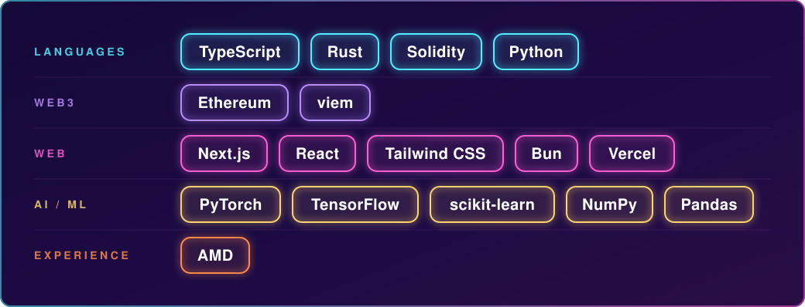

   
  🔖 Building AI x Web3 &nbsp;·&nbsp; ⛰️ Part-time hiker

## 🗂️ Past Projects

<table>
  <tr>
    <td colspan="2" valign="top">
      <b><a href="https://github.com/LingSiewWin/nearbuddy">nearbuddy</a></b> — stress-test AI trading agents in public  
      A public stress test for AI trading agents on NEAR: bonded, open to attack by anyone, every decision signed in an enclave and verified on chain.  
      <a href="https://nearbuddy.vercel.app">▶ Live</a> · <a href="https://github.com/LingSiewWin/nearbuddy">Source</a>
    </td>
  </tr>
  <tr>
    <td width="50%" valign="top">
      <b><a href="https://github.com/LingSiewWin/Tami">Tami</a></b> — the account you give your agents  
      Agents pay in USDC inside a mandate you signed once. Mandates on-chain, a book both sides sign, USDC on Arc.  
      <a href="https://tami-home.up.railway.app">▶ Live</a> · <a href="https://github.com/LingSiewWin/Tami">Source</a>
    </td>
    <td width="50%" valign="top">
      <b><a href="https://github.com/LingSiewWin/claudia">claudia</a></b> — an allowance, not your keys  
      The human authority layer for AI agents. The agent proposes, a deterministic engine checks the proposal against a mandate.  
      <a href="https://claudiahq.vercel.app/">▶ Live</a> · <a href="https://github.com/LingSiewWin/claudia">Source</a>
    </td>
  </tr>
  <tr>
    <td width="50%" valign="top">
      <b><a href="https://github.com/LingSiewWin/HumanMandate">HumanMandate</a></b> — spending rules bound to a person  
      An allowance bound to a person, not an address. Enforced in Solidity, with Uniswap execution and an on-chain slippage floor. Live on World Chain mainnet.  
      <a href="https://human-mandate.vercel.app/desk">▶ Live</a> · <a href="https://github.com/LingSiewWin/HumanMandate">Source</a>
    </td>
    <td width="50%" valign="top">
      <b><a href="https://github.com/LingSiewWin/grazey">grazey</a></b> — a grace period for agent payments  
      Every agent payment gets a grace period. Recourse for autonomous agent payments, on Arc.  
      <a href="https://github.com/LingSiewWin/grazey">Source</a>
    </td>
  </tr>
</table>

## 📈 GitHub Statistics

📊 Click to see more GitHub statistics

### Traditional GitHub Stats
  

### Contribution Streak

---

## 💻 Tech Stack

## 🌐 Socials
 
